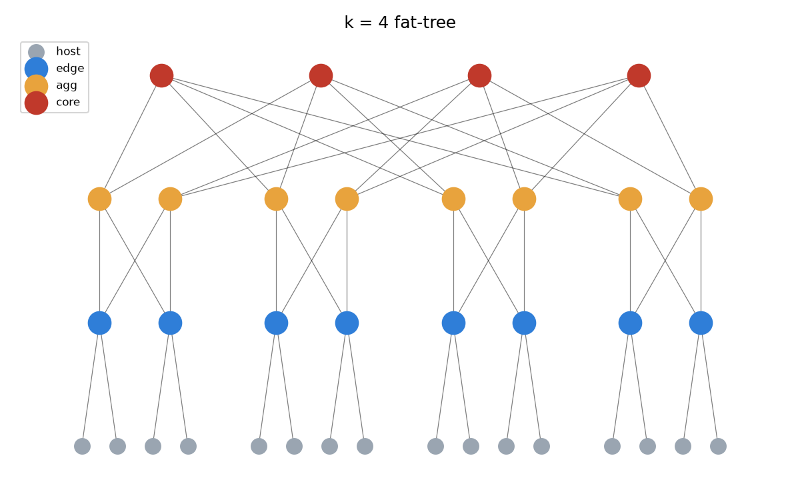
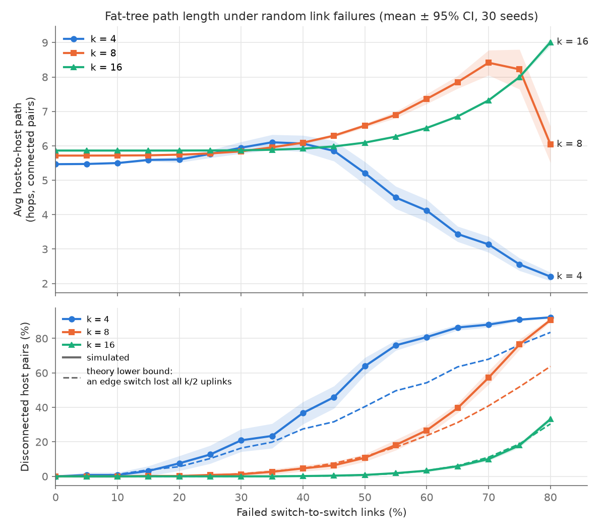
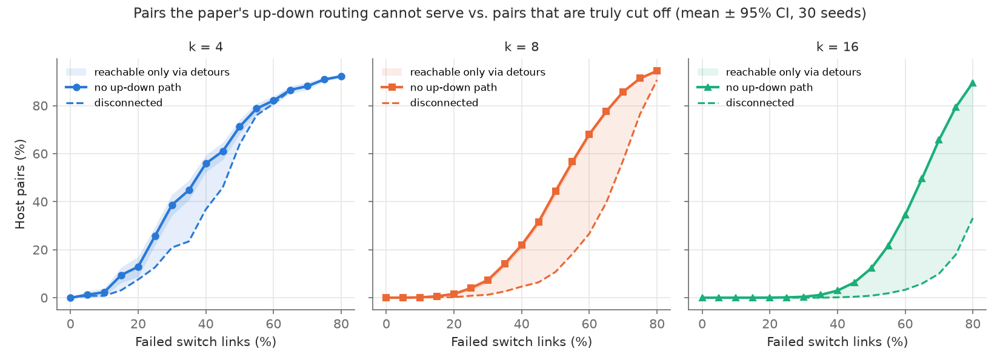

# Fat-Tree Generator & Failure Analysis

HW1, Communication Networks for Data Centers & AI (BGU, 2026–27)

Builds the 3-tier k-ary fat-tree from Al-Fares et al. [1] as a `networkx` graph, knocks out a random share of its links, and measures what that does to host-to-host paths.

## Quick start

Python ≥ 3.10.

```bash
pip install -r requirements.txt

python fattree.py --k 4                                # build and print a summary
python fattree.py --k 8 --fail 30 --seed 3             # same, with 30% of switch links failed
python fattree.py --k 4 --draw results/fattree_k4.png  # save a drawing
python experiment.py                                   # full sweep (~25 s), CSVs + plots in results/
pytest -q                                              # validation tests
```

```
k = 8 fat-tree
  hosts : 128
  edge  : 32
  agg   : 32
  core  : 16
  links : 307
  failed: 77 of 256 switch links (30%, seed 3)
  avg host-host path : 5.894 hops (connected pairs)
  disconnected pairs : 0.00%
```

## Inputs

| Flag | Default | Meaning |
|---|---|---|
| `--k` | required | Ports per switch. Even, ≥ 2. Sets the whole scale. |
| `--fail PCT` | 0 | % of switch-to-switch links to fail (0–100). |
| `--seed N` | 0 | Picks which links fail. Same seed, same failures. |
| `--draw PATH` | – | Save a layered drawing. Readable up to k = 6. |

Sweep settings (k values, failure range, number of seeds) are constants at the top of `experiment.py`.

## Topology

Everything is built from identical k-port switches:

| | Count |
|---|---|
| Pods | k |
| Edge / agg switches | k/2 each per pod |
| Core switches | (k/2)² |
| Hosts | k³/4 (k/2 per edge switch) |
| Links | 3k³/4 (k³/4 per layer) |

Core switches sit in a (k/2)×(k/2) grid. Agg switch *j* of every pod connects to the k/2 cores in row *j*, so each core has exactly one link into each pod and every switch uses all k ports.

Nodes have readable names (`host_p1_0_1`, `edge_p1_0`, `agg_p1_0`, `core_0_1`) plus `type`, `pod` and `addr` attributes. `addr` follows the paper's scheme: `10.pod.switch.id` for pod switches and hosts, `10.k.j.i` for cores (1-indexed grid position).



`test_fattree.py` checks, for k = 4, 6, 8: node counts, switch degree = k, host degree = 1, 3k³/4 links, connectivity, one core link per pod, and that odd k is rejected.

## Failure model

- **What fails:** only switch-to-switch links (edge–agg, agg–core), k³/2 in total. Host links never fail. A host has one link and no backup, so failing it just strands that host and tells us nothing about the fabric's redundancy.
- **How:** for p%, exactly round(p · k³/2) links are removed, uniformly at random. A given percentage always means the same number of failed links.
- **Reproducible:** sampling uses `random.Random(seed)`, and failures are applied to a copy of the graph.

## Metrics

1. **Average host-to-host shortest path (hops)**, over pairs that are still connected. On its own this number lies at high failure rates (it drops when long pairs disconnect), so I always report it next to the **fraction of disconnected pairs**.
2. **Fraction of pairs with no up-down path.** The paper's two-level routing only uses up-down paths (edge→agg→edge, or edge→agg→core→agg→edge), max 6 hops. In a fat-tree these are exactly the paths with the healthy length, so a pair has an up-down path iff its shortest path hasn't grown.

**How it's computed.** Host links never fail, so a host pair's distance is 2 (same edge switch) or dist(edge_a, edge_b) + 2. One BFS per edge switch gives the exact value over all pairs, no sampling. Both metrics are cross-checked in the tests against brute force.

**Sanity check at 0%.** With h = k/2, each host has h−1 neighbours at 2 hops, (h−1)h at 4 and (k−1)h² at 6:

$$\bar{d}_0 = \frac{2(h-1) + 4(h-1)h + 6(k-1)h^2}{k^3/4 - 1}$$

That gives 5.47, 5.72, 5.86 for k = 4, 8, 16, which is what the simulation measures.

**Lower bound on disconnection.** A pair is certainly cut off if either edge switch loses all k/2 uplinks. With n of N = k³/2 links failed, the chance that j specific links all failed is $H(j)=\prod_{i=0}^{j-1}\frac{n-i}{N-i}\approx p^j$, so

$$P(\text{pair cut}) \ge 2H(k/2) - H(k)$$

(the two edge switches have disjoint uplinks). The tests check that the bound holds in every sample and matches Monte Carlo.

## Results

### 1. Path length and disconnection vs. failure %



**Setup:** k = 4, 8, 16 (16 / 128 / 1,024 hosts), 0–80% failure in 5% steps, 30 seeds per point. Mean with 95% CI (normal approx.). Dashed lines are the lower bound above. Data: `results/path_length_raw.csv` (per seed), `results/path_length_summary.csv` (aggregated).

| Failure | k = 4: hops / disc. | k = 8 | k = 16 |
|---|---|---|---|
| 0% | 5.47 / 0% | 5.72 / 0% | 5.86 / 0% |
| 30% | 5.95 / 21% | 5.84 / 1.2% | 5.87 / 0% |
| 50% | 5.21 / 64% | 6.59 / 11% | 6.09 / 0.8% |
| 70% | 3.14 / 88% | 8.42 / 57% | 7.32 / 10% |
| 80% | 2.20 / 92% | 6.04 / 91% | 9.01 / 33% |

**What happens.** Three phases, and a bigger k pushes all of them to the right:

- **Flat.** A cross-pod pair has (k/2)² equal 6-hop paths. As long as one survives, nothing changes. For k = 16 (64 paths) the curve stays flat up to ~30%.
- **Stretch.** Once every shortest path between two edge switches is broken, traffic detours down to another edge switch and back up, +2 hops each time. Averages go above 6.
- **Collapse.** The average drops toward 2. That's survivorship, not recovery: long pairs disconnect first and only short ones are left in the average.

**Why k matters.** An edge switch is cut off only when all k/2 uplinks fail, ≈ p^(k/2). At 50% that's 25% for k = 4 and 0.4% for k = 16. For k = 8 and 16 the bound sits right on the simulated curve, so isolated edge switches are basically the only way pairs get cut. For k = 4 other cuts are cheap (a pod loses its 4 core links), so the simulation sits above the bound.

**Takeaway.** The fat-tree degrades gracefully, and robustness grows with k using the same commodity switches, which is the paper's argument. Path stretch shows up before disconnection, so it works as an early warning.

### 2. Up-down routability vs. failure %



**Setup:** same run. Solid line: pairs with no up-down path (the paper's routing can't serve them). Dashed: pairs physically disconnected. The gap is pairs that are reachable only through detours.

| Failure | k = 4: no up-down / disc. | k = 8 | k = 16 |
|---|---|---|---|
| 30% | 39% / 21% | 7.3% / 1.2% | 0.4% / 0% |
| 50% | 71% / 64% | 44% / 11% | 12% / 0.8% |
| 70% | 88% / 88% | 86% / 57% | 66% / 10% |

**What happens.** Up-down paths die much earlier than connectivity. At k = 16 and 70% failure, only 10% of pairs are disconnected but 66% have lost every up-down path. For k = 4 the curves almost overlap because there are few detours to begin with.

**Why.** A cross-pod up-down path needs 4 specific links alive, and there are (k/2)² of them. A detour can stitch together links from different paths, so it survives long after each clean path has lost a link. More ports means more ways to stitch, so the gap grows with k.

**Takeaway.** The physical network is far more robust than the paper's routing can use. Its failure broadcast (§3.8 of [1]) still only picks among up-down paths, so the solid line is the best case for that scheme. Getting the rest back needs routing that allows detours, like F10 [2]. A connected graph doesn't mean the network can deliver.

## AI usage

See [AI_USAGE.md](AI_USAGE.md).

## References

[1] M. Al-Fares, A. Loukissas, A. Vahdat, "A scalable, commodity data center network architecture," *SIGCOMM CCR*, vol. 38, no. 4, pp. 63–74, 2008. doi: 10.1145/1402946.1402967

[2] V. Liu, D. Halperin, A. Krishnamurthy, T. Anderson, "F10: A fault-tolerant engineered network," *USENIX NSDI*, 2013.
